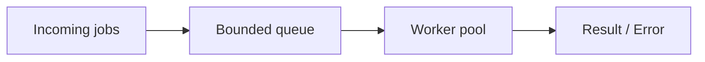

# Thread Pool cho batch job

## 1. Bản chất

Thread pool tái sử dụng worker threads để giới hạn số tác vụ chạy đồng thời. Khác với việc tạo `new Thread()` cho mỗi job,
pool giúp quản lý vòng đời và đặt chính sách khi queue đầy.



## 2. Ví dụ: fixed pool và shutdown

```java
import java.util.ArrayList;
import java.util.List;
import java.util.concurrent.*;

public class BatchExecutor {
    public static void run(List<String> jobIds) throws InterruptedException {
        ExecutorService pool = Executors.newFixedThreadPool(4);
        try {
            List<Future<?>> tasks = new ArrayList<>();
            for (String id : jobIds) {
                tasks.add(pool.submit(() -> process(id)));
            }
            for (Future<?> task : tasks) {
                try {
                    task.get(); // propagate task failures
                } catch (ExecutionException e) {
                    throw new IllegalStateException("Batch job failed", e.getCause());
                }
            }
        } finally {
            pool.shutdown();
            if (!pool.awaitTermination(30, TimeUnit.SECONDS)) {
                pool.shutdownNow();
            }
        }
    }

    private static void process(String id) {
        System.out.println("Processing " + id);
    }
}
```

!!! warning "FixedThreadPool vẫn có hàng đợi không giới hạn"
    `Executors.newFixedThreadPool` sử dụng queue không giới hạn theo contract; không phù hợp nếu producer có thể đẩy job vô hạn.
    Trong production, cân nhắc `ThreadPoolExecutor` với queue có giới hạn, rejection policy và metrics.

## 3. Edge cases

- `submit()` giữ exception bên trong `Future`; gọi `get()` để thấy thất bại.
- Tạo executor một lần ở service lifecycle thay vì tạo mỗi request.
- `shutdownNow()` gửi interrupt; task phải hợp tác kiểm tra interrupt.
- Chọn pool size phụ thuộc workload CPU-bound/I/O-bound và giới hạn downstream.

**Nguồn:** [ExecutorService](https://docs.oracle.com/en/java/javase/17/docs/api/java.base/java/util/concurrent/ExecutorService.html), [ThreadPoolExecutor](https://docs.oracle.com/en/java/javase/17/docs/api/java.base/java/util/concurrent/ThreadPoolExecutor.html).
