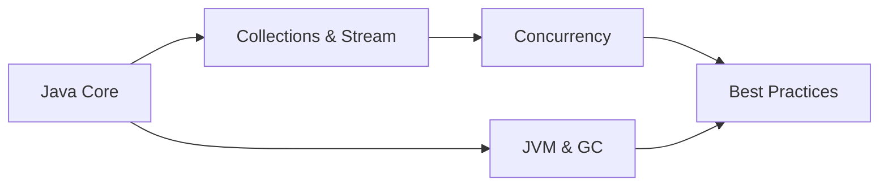

# Java Knowledge Base

**Học đúng bản chất, triển khai đúng cách, tái sử dụng được trong dự án thực tế.**

Tài liệu tập trung vào Java (JDK 17+) với những ví dụ thường gặp trong phát triển backend: xử lý đơn hàng, phân trang, API, batch job và quản lý tài nguyên.

!!! tip "Điểm bắt đầu"
    Nếu đang sử dụng Java 17, hãy đọc [Lộ trình học](getting-started/learning-path.md), sau đó chuyển sang [Java Core](core/index.md) và [Collections](collections/index.md).

## Sơ đồ kiến thức

## Các hướng tra cứu

| Mục | Cần tìm hiểu gì? |
| --- | --- |
| [Java Core](core/index.md) | Record, equals/hashCode, exception |
| [Collections & Stream](collections/index.md) | Chọn cấu trúc dữ liệu, xử lý nghiệp vụ |
| [Concurrency](concurrency/thread-pool.md) | Thread pool, CompletableFuture |
| [JVM](jvm/memory-gc.md) | Bộ nhớ, GC, chẩn đoán |
| [Best Practices](best-practices/index.md) | Clean code, null safety, tài nguyên |
| [Troubleshooting](troubleshooting/common-errors.md) | Triệu chứng → nguyên nhân → hướng xử lý |

## Quy ước viết tài liệu

- Một chủ đề có một trang chính; không nhân bản một giải pháp ở nhiều nơi.
- Luôn ghi điều kiện áp dụng, độ phức tạp và giới hạn của code nếu liên quan.
- Ưu tiên [Oracle Java Documentation](https://docs.oracle.com/en/java/) và [Java Language Specification](https://docs.oracle.com/javase/specs/).
- Vấn đề thực chiến viết thành case ở **Troubleshooting**, sau đó liên kết sang kiến thức nền.
